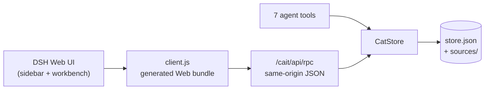

<p align="center">
  
</p>

<h1 align="center">CAIT</h1>

<p align="center">
  <strong>DeepSeek Harness の中で使うコンピュータ支援翻訳。</strong><br/>
  翻訳メモリ · 用語集 · セグメントエディタ · MT 支援 · 文書タブ · Office / 字幕 / ローカリゼーション形式
</p>

<p align="center">
  <a href="README.md">English</a> · <a href="README.zh-CN.md">简体中文</a> · <a href="README.ja.md">日本語</a>
</p>


<p align="center">
  <a href="https://www.npmjs.com/package/dsh-cait"></a>
  
  
  
</p>

CAIT は DSH Web UI と DSH デスクトップに CAT ワークベンチを追加します。左サイドバーの
エントリから開き、ワークベンチと 7 つのエージェントツールが 1 つのストアを共有するため、
ソースファイルのインポートから訳文のエクスポートまでを一通りこなせます。

> **DSH `0.2.2-rc.1` で動作確認済み。** CAIT は DSH 自身のモデルルートと認証情報を
> 使うため、API キーを要求しません。内部のフォールバックプロバイダは今も `mock` と
> いう名前ですが、UI では **用語置換（オフライン）** と表示されます。

## CAIT を選ぶ理由

| | |
|---|---|
| **DSH ネイティブ** | 本物のサイドバーパネル、メインワークベンチ、DSH のテーマトークン、そして人とエージェントが同じストアを共有。iframe でも別アプリでもありません。 |
| **説明できる翻訳メモリ** | 複数の TM ライブラリ、マウント済みライブラリのみの検索、完全一致 / ほぼ完全一致 / 高・中・低ファジーの段階、確定時の自動書き戻し。 |
| **用語を意識した編集** | 複数の用語集、ソース言語による絞り込み、インライン強調、用語のクリック挿入、用語ごとの大文字小文字の区別。 |
| **文書ワークフロー** | タブ、閉じる / 開き直し、最近の文書の整理、同一内容の再インポート再利用、文書ごとの進捗。 |
| **実用的な形式対応** | TXT、Markdown、DOCX、EPUB、TMX、CSV、SRT/VTT、PO、XLIFF 1.2/2.0/SDLXLIFF、HTML、JSON、XLSX、PPTX、RTF。 |
| **エージェント対応** | 7 つのツールが開いている文書とストアを共有するので、エージェントと並行して翻訳できます。 |

## クイックスタート

1. CAIT をインストールし、左サイドバーの **CAIT** 行から開きます。
2. **新規ページ** を選び、ソースファイルをドロップするかテキストを貼り付けます。
3. ソース言語とターゲット言語を設定します。
4. 現在のセグメントを翻訳します。右パネルに TM の一致、用語のヒット、MT の候補が
   表示されます。
5. **確定して次へ** を押すと、その対が既定のマウント済み TM に書き込まれます。
6. 訳文のみ、対訳、または元の形式を保った文書としてエクスポートします。

エディタへの入力はドラフトであり、メモリ上に留まります。セグメントの確定（または明示的な
構造変更）のときにスナップショットが書き込まれます。開いているワークベンチは 2 秒ごとに
Host のリビジョンをポーリングするため、エージェントによる変更も手動リロードなしで反映されます。

## 機能

### 翻訳メモリ

- id、名前、マウント状態、既定の書き込みライブラリを持つ複数の TM ライブラリ。
- 完全一致、ほぼ完全一致、そして 3 つのファジー帯:
  - `near_exact` は数字・句読点・空白を無視したキーで比較し、スコアのしきい値には
    依存しません。
  - `high_fuzzy` は `>= 0.85`、`medium_fuzzy` は `0.75–0.85`、`low_fuzzy` は
    `0.75` 未満（設定可能な下限、既定値 `0.55` より上）です。
- ファジースコアは字句ベースです。文字バイグラムの Dice 72% + トークンの Jaccard 28%。
  ラテン文字は単語単位、CJK は文字単位で扱います。ステミング、同義語、意味的マッチングは
  行いません。
- 検索対象はマウント済みのライブラリだけです。`cat_submit_translation` は任意の
  `targetTmId` を受け付け、マウントされていない指定は `TM_NOT_MOUNTED` で拒否されます。
- `bootstrap().tm.entries` はマウント済みエントリの 40 件プレビュー、
  `bootstrap().tm.count` はマウント済み件数、`bootstrap().tm.total` は全ライブラリの
  件数です。全データが必要な場合は `cat_lookup_tm` かライブラリモーダルを使ってください。
- TMX 1.4 の `<tu>/<tuv>/<seg>` インポート / エクスポート。TMX のインライン
  プレースホルダは、明示的な警告とともにプレーンテキストへ平坦化されます。

### 用語集

- マウント状態と既定の書き込みライブラリを持つ複数の用語集ライブラリ。
- ソースのライブ強調表示と、クリックで挿入できる用語チップ。
- CSV/TSV インポート、用語ごとのメモ、ソース言語による絞り込み、そしてワークベンチと
  `cat_lookup_glossary` の両方が尊重する `caseSensitive` フラグ。
- 言語コードは正規化されます（`EN` → `en`、`ZH_cn` → `zh-CN`）。

### ワークベンチ

- 段落 / 文単位のセグメンテーションと、セグメントごとのターゲットエディタ。
- セグメントは **未翻訳** → **翻訳済み** → **確定済み** の 3 状態を持ち、訳文の由来
  （`tm`、`mt`、`agent`、`manual`）も記録します。レールは状態で絞り込め、検索は
  原文・訳文・サジェストを対象にします。
- **事前翻訳**: TM の完全一致と機械翻訳で文書全体を小さなブロック単位で埋め、
  `完了/総数` を表示し、ブロックの間で停止できます。確定済み・訳文のあるセグメントは
  上書きしません。
- **縦積みレビュー**: 原文・機械/agent のベースライン・編集可能な訳文を上から下へ
  並べ、各ブロックがパネルの幅いっぱいを使います。**すべて確定** は確認ダイアログ
  1 回でレビュー待ちをまとめて受け入れます。
- ドラフト保存、確定して次へ、前後移動、進捗表示。選択中のセグメントとドラフトは
  デバウンスして保存されるため、再起動後も続きから再開できます。
- レールの QA マーカーと書き出し前の集計: プレースホルダー / タグの欠落、数字の
  不一致、用語の未使用、空の訳文。注意のみで、書き出しは妨げず、保存もしません。
- 文書タブ。タブを閉じても文書は削除されません。
- **既存の文書を開く** で、閉じた文書を開き直せます。
- **設定 → インターフェース** の UI 言語切り替え: *DSH の言語に従う*（既定）、
  简体中文、English、日本語。ワークベンチとサイドバーのラベルに即座に反映され、
  変わるのは CAIT の UI だけです。文書のソース言語・ターゲット言語には影響しません。
- ピッカーの隣のゴミ箱ダイアログは、閉じた文書を 1 件またはすべて削除します。削除は
  元に戻せず、TM・用語集・その他の文書には触れません。
- 同じ形式で同一内容を再インポートすると、重複を作らず既存の文書を再利用します。
  フィンガープリントは言語、ソース、形式、交換メタデータを対象にします。
- レスポンシブな密度: ワークベンチは自身の DSH パネルを測り、減衰させた `--cait-u`
  倍率を 1×–1.45× で適用します。1600×900 のパネルは約 1.17×、最大化した 4K でも
  1.45× で止まり、ホスト UI に近い大きさを保ちます。
- ワークベンチは DSH のライト / ダークテーマに追従し、ネイティブコントロール
  （`color-scheme`）も含めてセレクト、チェックボックス、スクロールバーが揃います。

### 前処理

インポートした原文は、分割の前に前処理ステージを通ります:

- 連続する空白とタブを畳み、行頭のインデントを除き、連続する空行をまとめます。
- ゼロ幅文字と余分な制御文字を除去します。
- プレースホルダートークン（`{1}`、`{2}`…）、句読点、大文字小文字、段落順は
  変更しません。XLIFF/HTML/EPUB のインラインマークアップはそのまま往復できます。
- 3 つの手順は **設定 → 前処理** で個別に切り替えられ、他の設定と一緒に保存されます。
  新しいインポートと `createDocument` 呼び出しに適用され、既存の文書は書き換えません。

### MT 支援

CAIT はエンドポイントもキーも持ちません。セレクタは DSH から組み立てます:

- `ctx.llm.listProviders()` が登録済みのプロバイダルートを返します。
- `ctx.loader.entries()` があれば `config.providers` のために参照します。
- `ctx.llm.listModels(provider)` がモデル id を返し、CAIT は既定で先頭のモデルを選びます。
- `ctx.llm.stream({ provider, model, messages, temperature, purpose: 'cait-mt' })`
  が呼び出しを行い、CAIT は `text-delta` チャンクを連結します。

使えるルートが無い場合、選択したルートが消えた場合、またはモデルが無い場合は、CAIT は
オフラインの用語置換にフォールバックし、その旨を UI と `cat_suggest_mt` の結果に明記します。
ストリームの失敗は Host に provider/model/code/status として記録され、クライアントが受け取る
のは `MT_PROVIDER_FAILED` だけです。

## 対応形式

| 形式 | インポート | エクスポート | 備考 |
| --- | :---: | :---: | --- |
| TXT / Markdown | ✅ | ✅ | 段落と文のセグメンテーション |
| CSV | ✅ | ✅ | カンマ、セミコロン、タブ、パイプの区切りを自動判定。ヘッダー名または 1 始まりの番号でソース / ターゲット列を指定可能。既存の対訳エクスポートにも対応 |
| DOCX | ✅ | ✅ | 本文段落。表ブロックはインポート対象外。エクスポートは元のパッケージにパッチを当て、スタイル、番号付け、画像、ヘッダー、表、レイアウトを保つ |
| EPUB | ✅ | ✅ | EPUB 3 の spine 順に XHTML テキストブロックを読み、インライン要素をトークンとして保持し、保持したソースパッケージに書き戻す。DRM、固定レイアウト、スクリプト化された EPUB は非対応 |
| TMX 1.4 | ✅ | ✅ | 一般的な `<tu>/<tuv>/<seg>` サブセット。インライン要素は警告付きで平坦化 |
| SRT / WebVTT | ✅ | ✅ | 1 キュー = 1 セグメント。タイミング / 設定 / 識別子を保持し、セマンティックタグも維持。不正な範囲は拒否 |
| PO | ✅ | ✅ | コンテキスト、複数形、翻訳者コメント、廃止された `#~` エントリ |
| XLIFF 1.2 | ✅ | ✅ | インラインタグは `{n}` トークンになり、欠落していると確定できない |
| XLIFF 2.0 | ✅ | ✅ | `<unit><segment><source>/<target>` の基本サブセット |
| SDLXLIFF | ✅ | ✅ | XLIFF 1.2 の基本パス。SDL 固有の拡張はラウンドトリップしない |
| HTML | ✅ | ✅ | テキストブロックとインラインタグを保持。文書全体の CSS / レイアウトは再構築しない |
| JSON | ✅ | ✅ | 文字列パスのサブセット。オブジェクト / 配列構造はテンプレートで保持。キーと数値は翻訳しない |
| XLSX | ✅ | ✅ | 最初のワークシート。`Source`/`Target` ヘッダーまたは A/B 列。エクスポートは 2 列の新しいワークブック |
| PPTX | ✅ | ✅* | ソース保持エクスポート。インポートした `.pptx` パッケージが必要。本文テキストのみで、ノート / グラフ / SmartArt はインポートしない |
| RTF | ✅ | ✅ | 基本的な段落、`\uN`、`\'hh`、制御語。元のスタイルはラウンドトリップしない |

\* 保持していたソースパッケージが無い場合、PPTX エクスポートは書式なしのデッキを黙って
作るのではなく `PPTX_SOURCE_REQUIRED` で失敗します。

交換メタデータ（字幕のタイミング、PO のコンテキスト / 複数形 / コメント、XLIFF の id と
インライントークンマップ、JSON のパス / テンプレート、XLSX の行、PPTX のスライド /
段落位置、EPUB の spine href とブロック番号）は文書とセグメントに保持され、
スナップショットに永続化されます。

### PDF はサポートされません

CAIT は PDF をインポートせず、今後のリリースでも PDF 対応を追加しません。PDF は
固定レイアウトの印刷形式で、論理的な段落、読み順、インラインマークアップを持ちません。
抽出したテキストは描画命令の間に断片化し、見出し、表、インライン強調が失われるため、
翻訳メモリや MT にとって質の低い入力になります。つまり PDF は AI 関連の作業に
極めて不向きです。

PDF の内容を翻訳する場合は、先にサポート形式へ変換してください。例えば:

```sh
pandoc input.pdf -t docx -o output.docx   # または -t html、-t markdown
```

Adobe Acrobat の **Word/HTML へエクスポート**、LibreOffice、その他 DOCX、HTML、
EPUB、プレーンテキストを生成できるツールでも構いません。スキャン PDF は変換前に
OCR が必要です。CAIT に画像 OCR ステージはありません。

## インストール

CAIT は DSH の bundle としてインストールします。公開パッケージ名は `dsh-cait` で、
プラグイン自体は左サイドバーに **CAIT** として表示されます。`desktop` プロファイルは
アプリのプラグインマネージャが管理するため、プロファイルの `package.json` を手で編集せず
そちらを使ってください。

### npm から

DSH デスクトップ（または `plugin_manager` ツールがある任意のプロファイル）で:

```text
plugin_manager install_bundle target: dsh-cait
```

バージョンを固定するときは `dsh-cait@1.1.0`、最新版は `dsh-cait@latest` を指定します。
マネージャが registry のパッケージを解決し、bundle patch を適用してプラグインを有効化します。

CLI 管理のプロファイル:

```sh
dsh plugin --profile web add dsh-cait
```

`web` はご自身のプロファイル名に置き換えてください。必要なら `dsh web` を再起動します。

### このリポジトリから

GitHub:

```text
plugin_manager install_bundle target: github:JoviLecca/dsh-CAIT
```

ローカルのチェックアウト:

```text
plugin_manager install_bundle target: /absolute/path/to/dsh-CAIT
```

その後 DSH をリロードすると、左サイドバーに **CAIT** のエントリが現れます。

### ソースから

```sh
git clone <this-repository> dsh-CAIT
cd dsh-CAIT
npm run build:client
```

ローカルの `--patch` オーバーレイを使う場合は、このディレクトリを指す行を追加します:

```yaml
# _dev/cait.patch.yml
- insert:
    - id: cait-dev
      name: 'C:\absolute\path\to\dsh-CAIT'
```

```powershell
dsh web --patch C:\absolute\path\to\dsh-CAIT\_dev\cait.patch.yml
```

`--patch` はランチャーのオプションです。アプリ名（`web`）の後、アプリの引数の前に
置いてください。オーバーレイとプロファイルにインストールしたバンドルは併用せず、
どちらか一方にしてください。

## 設定

| オプション | 既定値 | 意味 |
| --- | --- | --- |
| `dataDir` | `""` | `store.json` と `sources/` を置くディレクトリ。空なら `$DSH_HOME/cait`。絶対パス、相対パス、`~/...` を受け付けます。 |

```yaml
- id: dsh-cait
  name: dsh-cait
  config:
    dataDir: 'D:\CAT\cait-data'
```

スナップショットには文書、開いているタブ、TM、用語集、ライブラリ、マウント、そして
秘密でない設定が保存されます。インポートした DOCX/PPTX/EPUB のソースパッケージは `sources/`
に置かれます。

アプリ内設定（**設定**）は上記の YAML ではなくスナップショットに保存されます: ソース /
ターゲット言語、ファジーしきい値、TM の結果件数、MT のルート / モデル / temperature、
そして UI 言語（`uiLang`: `auto` | `zh` | `en` | `ja`、既定の `auto` = DSH のロケールに
従う）。セグメントの確定は厳格な書き込みで、スナップショットを書けない場合は確定が
`PERSISTENCE_FAILED`（503）で失敗し、メモリ上の確定もロールバックされます。その他の
構造的な編集はベストエフォートで、`bootstrap().storage.error` がワークベンチの
バナーに表示されます。

スナップショットが破損している、または未知のバージョンの場合、CAIT は警告をログに残し、
`store.json.corrupt-<timestamp>` に退避してから空の状態で起動します（有効化は失敗しません）。
バージョン 1・2 のスナップショットは、既定の TM と用語集ライブラリを付けてバージョン 3 へ
移行されます。バージョン 2 で「訳文はあるが未確定」のドラフトは `translated` になり、
由来は `manual` として記録されます。

## エージェントツール

| ツール | 用途 |
| --- | --- |
| `cat_get_segment` | 現在のセグメントと TM の一致、用語のヒット |
| `cat_submit_translation` | 訳文を確定し、マウント済み TM へ書き込み（任意の `targetTmId`）、次へ進む |
| `cat_lookup_tm` | マウント済みライブラリを横断した段階付き TM 検索 |
| `cat_lookup_glossary` | マウント済み用語集の検索。`caseSensitive` を尊重 |
| `cat_list_documents` | 文書と進捗の一覧 |
| `cat_switch_document` | アクティブな文書を切り替え |
| `cat_suggest_mt` | 選択した DSH ルート経由の MT、または明示的なオフラインフォールバック |
| `cat_pre_translate` | TM + MT で 1 ブロックを埋め、確定済み・訳文ありは飛ばし `next` を返す |
| `cat_get_segments` | 状態・由来・サジェスト付きで、範囲を限ったセグメント一覧 |
| `cat_confirm_segments` | インデックス一覧、範囲、またはレビュー待ち全体を確定 |

そのためエージェントは UI を操作せずに文書全体を下書きできます: `cat_pre_translate` を
`from: next` で `next` が `null` になるまで繰り返し、`cat_get_segments` で確認し、
`cat_confirm_segments` でまとめて受け入れます。

ワークベンチとツールは 1 つの `CatStore` を共有するため、エージェントはユーザーが開いて
いるのと同じ文書を翻訳できます。

## アーキテクチャ



- **Host**（`index.js`、`lib/`）がストア、永続化、インポート / エクスポート、ツール、
  そしてプライベート API を持ちます。
- **Client**（`client/`）は DSH のモジュールローダーで読み込まれる素の React で、
  `sidebar.panellist` と `main` に描画されます。スタイルは `--dsw-alias-*` トークンだけを
  使います。
- `client.js` は生成物です。`client/*.js` を編集して `npm run build:client` を実行して
  ください。

<details>
<summary><strong>プロジェクト構成</strong></summary>

```text
cait/
├─ package.json
├─ cordis.patch.yml
├─ index.js                 # Host 側
├─ client.js                # 生成された Web バンドル
├─ client/                  # helpers, styles, RPC, components, locales, entry
├─ scripts/build-client.mjs
├─ icon.svg
├─ locale/{en,zh,ja}.json
├─ NOTICE
├─ README.md
├─ README.zh-CN.md
├─ README.ja.md
├─ CHANGELOG.md
├─ lib/
│  ├─ store.js              # CatStore ファサード + 文書 / セグメントの中核
│  ├─ errors.js
│  ├─ store-utils.js
│  ├─ libraries.js          # TM / 用語集レジストリとマウント
│  ├─ tm.js
│  ├─ glossary.js
│  ├─ persistence.js
│  ├─ import-export.js
│  ├─ formats.js            # CSV/SRT/VTT/PO/XLIFF/HTML/JSON/RTF
│  ├─ html.js               # HTML/XHTML テキストラン走査と書き戻し
│  ├─ epub.js               # EPUB パッケージ読み込み / spine インポート / パッチ書き出し
│  ├─ preprocess.js         # インポート時の原文前処理ステージ
│  ├─ xlsx.js
│  ├─ pptx.js
│  ├─ segmenter.js
│  ├─ similarity.js
│  ├─ tmx.js
│  ├─ docx.js
│  ├─ markdown.js
│  ├─ xml.js
│  ├─ mt.js
│  ├─ tools.js
│  └─ api.js
└─ _dev/                    # テスト、フィクスチャ、ローカルパッチのオーバーレイ
```

</details>

## 開発

Node.js 22+ と DSH `0.2.x` が必要です。DSH `0.2.2-rc.1` と Node `26.7.0` で動作確認済み。

```sh
npm run build:client
node --check client.js

node _dev/test-core.mjs
node _dev/test-imports.mjs
node _dev/test-formats.mjs
node _dev/test-epub.mjs
node _dev/test-preprocess.mjs
node _dev/test-second-tier.mjs
node _dev/test-docx-export.mjs
node _dev/test-api.mjs
node _dev/test-plugin.mjs
node _dev/test-persistence.mjs
node _dev/test-documents.mjs
node _dev/test-libraries.mjs
node _dev/test-mounts.mjs
node _dev/test-ui-scale.mjs
node _dev/test-mt.mjs
```

インポート / エクスポートのフィクスチャは `_dev/sample.docx`、`_dev/sample-table.docx`、
`_dev/sample-format.docx` です。対応する `python _dev/make-*.py` スクリプトで再生成
できます。15 スイートすべてが通るはずです。

### リリース

`npm publish` は `prepublishOnly` を実行し、`client/` のフラグメントから
`client.js` を再ビルドして構文チェックするため、古いバンドルが出荷されることは
ありません。リポジトリのルートで実行します:

```sh
npm publish
```

`.github/workflows/publish.yml` は GitHub で release を公開したときに同じ処理を
CI で行い、保存したトークンではなく npm Trusted Publishing（OIDC）を使います。
release タグが `package.json` のバージョンと一致しない場合は公開を拒否します。

最初のリリースだけはローカルで公開する必要があります。Trusted Publishing は
既に存在するパッケージにしか設定できないためです:

```sh
npm login
npm publish
```

その後 npmjs.com でパッケージを開き、**Settings → Trusted publishing** で
リポジトリ `JoviLecca/dsh-CAIT` とワークフローファイル `publish.yml` を追加します。
以降のリリースは GitHub の release から公開できます。

## セキュリティモデル

- Host API は `/cait/api` にマウントされ、`ctx.connection.requestRejection` によって
  同一オリジン / 信頼済みリクエストに制限されます。
- RPC のボディは JSON で 32 MB まで。超過すると `413 BODY_TOO_LARGE` を返します。
- `clearTM` / `clearGlossary` はブラウザの信頼チェックに加えて `params.confirm === true`
  を要求します。UI は送信前に確認します。
- CAIT は API キーを受け取らず、保存せず、返しません。DSH の認証情報は選択したプロバイダ
  アダプタの中に留まります。
- 永続化は最終書き込み優先の単一スナップショットであり、複数ユーザー向けのジャーナルでは
  ありません。

## 既知の制限とロードマップ

- PDF のインポートは非対応で、今後も対象外です（[PDF はサポートされません](#pdf-はサポートされません)）。
  画像 OCR も未対応です。
- EPUB インポートは spine 内の本文 XHTML テキストブロックのみを対象とします。
  DRM、固定レイアウト、スクリプト化、MathML を多用する書籍は非対応です。
- DOCX インポートは表、ヘッダー、脚注、フィールド、代替テキスト、変更履歴の削除を
  スキップします。DOCX エクスポートではそれらの領域はソース言語のまま残ります。
- 複数の run が混在する DOCX/PPTX の段落は、先頭 run の書式を継承します。
- PPTX インポートは本文テキストのみで、ノート、グラフ、SmartArt は対象外です。
- XLSX のインポート / エクスポートは 2 列の表です。セルのスタイル、数式、結合セル、画像、
  追加シートは保持されません。
- HTML/RTF のエクスポートは元のスタイルをラウンドトリップしません。JSON は文字列値だけを
  翻訳します。
- TM のマッチングは意味ではなく字句に基づきます。ステミング、同義語、埋め込みはありません。
- ワークベンチ UI は中国語・英語・日本語の 3 言語で、設定から切り替えられます。
  README も英語・簡体字中国語・日本語の 3 版があり、英語版が正本です。

次に予定しているのは、マルチモーダルな DSH ルート経由の画像 / ビジョン入力、
スタイルを保つ XLSX 出力、XLIFF の `<alt-trans>` / ノート対応です。

## 変更履歴とバージョン

[CHANGELOG.md](CHANGELOG.md) を参照してください。`v1.0.0` が最初の公開リリースで、
`v1.0.1` が日本語 UI とアプリ内の UI 言語切り替えを追加し、`v1.0.2` で
*DSH の言語に従う* が DSH のロケールに従うようになり、`v1.0.3` で npm に公開、
`v1.0.4` から以降のリリースは provenance 付きの公開ワークフローで行われ、
`v1.0.5` で EPUB、インポート前処理、PDF ポリシーを、`v1.1.0` でエージェントによる
事前翻訳、セグメントの 3 状態、縦積みレビュー、軽量 QA を追加しました。
プロジェクトは `0.1.0` として開発され、GitHub リリースに向けて採番し直されました。

> **ライセンス:** Apache License 2.0 — [LICENSE](LICENSE) を参照してください。
> 再配布時は [NOTICE](NOTICE) の帰属表示を保持する必要があります。
