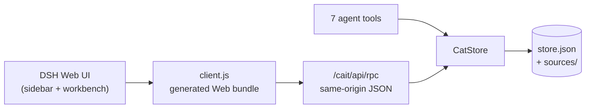

<p align="center">
  
</p>

<h1 align="center">CAIT</h1>

<p align="center">
  <strong>Computer-aided translation, inside DeepSeek Harness.</strong><br/>
  Translation memory · glossary · segment editor · MT assistance · document tabs · Office / subtitle / localization formats
</p>
<p align="center">
  <a href="README.zh-CN.md">简体中文</a> · <a href="README.ja.md">日本語</a> · <a href="README.md">English</a>
</p>


<p align="center">
  
  
  
  
</p>

CAIT adds a CAT workbench to the DSH Web UI and Desktop. It opens from a
left-sidebar entry, keeps one shared store behind the workbench and seven agent
tools, and covers the practical path from importing a source file to exporting a
translated document.

> **Tested with DSH `0.2.2-rc.1`.** CAIT uses DSH's own model routes and
> credentials; it never asks for an API key. The internal fallback provider is
> still called `mock`, but the UI labels it **Glossary substitution (offline)**.

## Why CAIT

| | |
|---|---|
| **Native to DSH** | A real sidebar panel, a main workbench, DSH theme tokens, and the same store for humans and agents. No iframe, no separate app. |
| **TM that explains itself** | Multiple TM libraries, mounted-only lookup, exact / near-exact / high / medium / low fuzzy grades, and automatic write-back on confirm. |
| **Glossary-aware editing** | Multiple term bases, source-language filtering, inline highlighting, click-to-insert terms, and per-term case sensitivity. |
| **A document workflow** | Tabs, close/reopen, recent-document cleanup, duplicate-import reuse, and progress per document. |
| **Real format coverage** | TXT, Markdown, DOCX, TMX, CSV, SRT/VTT, PO, XLIFF 1.2/2.0/SDLXLIFF, HTML, JSON, XLSX, PPTX, and RTF. |
| **Agent-ready** | Seven tools share the open document and store, so an agent can translate alongside you. |

## Quick start

1. Install CAIT and open it from the **CAIT** row in the left sidebar.
2. Choose **New page**, then drop a source file or paste text.
3. Set the source and target languages.
4. Translate the current segment; the right panel shows TM matches, glossary hits,
   and an MT suggestion.
5. **Confirm & next** writes the pair to the default mounted TM.
6. Export target-only, bilingual, or a format-preserving document.

Typing in the editor is a draft and stays in memory. Confirming a segment (or an
explicit structural change) writes the snapshot. The open workbench polls the
Host revision every two seconds, so changes made by an agent appear without a
manual reload.

## Features

### Translation memory

- Multiple TM libraries with id, name, mount state, and a default write library.
- Exact, near-exact, and three fuzzy bands:
  - `near_exact` compares a key that ignores digits, punctuation, and whitespace;
    it does not depend on a score cutoff.
  - `high_fuzzy` is `>= 0.85`, `medium_fuzzy` is `0.75–0.85`, `low_fuzzy` is
    below `0.75` (above the configurable floor, default `0.55`).
- Fuzzy scoring is lexical: 72% character-bigram Dice + 28% token Jaccard.
  Latin text uses words; CJK text uses individual characters. There is no
  stemming, synonym, or semantic matching.
- Lookups only see mounted libraries. `cat_submit_translation` accepts an optional
  `targetTmId`; an unmounted target is rejected with `TM_NOT_MOUNTED`.
- `bootstrap().tm.entries` is a 40-entry preview of mounted entries;
  `bootstrap().tm.count` is the mounted count and `bootstrap().tm.total` is the
  all-library count. Use `cat_lookup_tm` or the library modal for full data.
- TMX 1.4 `<tu>/<tuv>/<seg>` import/export. Inline TMX placeholders are flattened
  to plain text with an explicit warning.

### Glossary

- Multiple glossary libraries with mount state and a default write library.
- Live source highlighting and click-to-insert term chips.
- CSV/TSV import, per-term notes, source-language filtering, and a
  `caseSensitive` flag honored by both the workbench and `cat_lookup_glossary`.
- Language codes are canonicalized (`EN` → `en`, `ZH_cn` → `zh-CN`).

### Workbench

- Paragraph/sentence segmentation with a per-segment target editor.
- Draft saving, confirm-and-next, previous/next navigation, and progress.
- Document tabs; closing a tab does not delete the document.
- **Open existing document** reopens a closed document.
- Interface language switch in **Settings → Interface**: *Follow DSH language*
  (default), 简体中文, English, or 日本語. It applies to the workbench and the
  sidebar label right away, and changes only the CAIT UI — never the document's
  source or target language.
- The trash dialog beside the picker deletes one closed document or all closed
  documents; deletion is permanent and does not touch TM, glossary, or other
  documents.
- Re-importing identical content in the same format reuses the existing document
  instead of creating a duplicate. The fingerprint covers languages, source,
  format, and exchange metadata.
- Responsive density: the workbench measures its DSH panel and applies a
  `--cait-u` multiplier of 1×–1.8×. A 1600×900 panel renders at ~1.32× and a
  2560×1440 panel at 1.8×; short windows stay at 1× rather than shrinking.

### MT assistance

CAIT does not own an endpoint or key. The selector is built from DSH:

- `ctx.llm.listProviders()` supplies registered provider routes.
- `ctx.loader.entries()` is consulted for `config.providers` when available.
- `ctx.llm.listModels(provider)` supplies model ids; CAIT selects the first model
  by default.
- `ctx.llm.stream({ provider, model, messages, temperature, purpose: 'cait-mt' })`
  performs the call; CAIT concatenates `text-delta` chunks.

If no usable route exists, the selected route disappears, or it has no models,
CAIT falls back to offline glossary substitution and says so in the UI and in the
`cat_suggest_mt` result. Stream failures are logged in the Host with
provider/model/code/status; the client receives only `MT_PROVIDER_FAILED`.

## Supported formats

| Format | Import | Export | Notes |
| --- | :---: | :---: | --- |
| TXT / Markdown | ✅ | ✅ | Paragraph and sentence segmentation |
| CSV | ✅ | ✅ | Optional source/target column by header name or 1-based number; existing bilingual export |
| DOCX | ✅ | ✅ | Body paragraphs; table blocks are excluded from import. Export patches the original package, keeping styles, numbering, images, headers, tables, and layout. |
| TMX 1.4 | ✅ | ✅ | Common `<tu>/<tuv>/<seg>` subset; inline markup flattened with warning |
| SRT / WebVTT | ✅ | ✅ | One cue per segment, timings/settings/identifier retained; semantic tags kept; invalid ranges rejected |
| PO | ✅ | ✅ | Contexts, plural forms, translator comments, obsolete `#~` entries |
| XLIFF 1.2 | ✅ | ✅ | Inline tags become `{n}` tokens; missing tokens block confirmation |
| XLIFF 2.0 | ✅ | ✅ | Basic `<unit><segment><source>/<target>` subset |
| SDLXLIFF | ✅ | ✅ | Basic XLIFF 1.2 path; SDL-specific extensions are not round-tripped |
| HTML | ✅ | ✅ | Text blocks only; original markup/CSS not preserved |
| JSON | ✅ | ✅ | String-path subset; object/array structure preserved via a template; keys and numbers are not translated |
| XLSX | ✅ | ✅ | First worksheet; `Source`/`Target` headers or columns A/B; export is a new two-column workbook |
| PPTX | ✅ | ✅* | Source-preserving export; requires the imported `.pptx` package. Body text only; notes/charts/SmartArt not imported. |
| RTF | ✅ | ✅ | Basic paragraphs, `\uN`, `\'hh`, control words; original styling not round-tripped |

\* PPTX export fails with `PPTX_SOURCE_REQUIRED` when the retained source package
is missing rather than silently producing an unformatted deck.

Exchange metadata (subtitle timings, PO contexts/plurals/comments, XLIFF ids and
inline token maps, JSON paths/templates, XLSX rows, PPTX slide/paragraph positions)
is stored on the document/segments and persists in the snapshot.

## Install

### DSH Desktop

Install the local package through the in-app plugin manager (the `desktop` profile
is owned by the Electron app). The package name is `dsh-cait`; the plugin itself
shows up as **CAIT** in the left sidebar.

From this repository:

```text
plugin_manager install_bundle target: github:JoviLecca/dsh-CAIT
```

From a local checkout:

```text
plugin_manager install_bundle target: /absolute/path/to/dsh-CAIT
```

Then reload DSH. The **CAIT** entry appears in the left sidebar.

### `dsh` CLI (Web / CLI-managed profile)

```sh
git clone <this-repository> dsh-CAIT
dsh plugin --profile web add /absolute/path/to/dsh-CAIT
```

Replace `web` with your profile name. Restart `dsh web` if your host requires it.
The Desktop app manages its own profile; install through the app's Plugins page
or the plugin manager instead of a CLI profile.

### From source

```sh
git clone <this-repository> dsh-CAIT
cd dsh-CAIT
npm run build:client
```

For a local `--patch` overlay, add a row pointing at this directory:

```yaml
# _dev/cait.patch.yml
- insert:
    - id: cait-dev
      name: 'C:\absolute\path\to\dsh-CAIT'
```

```powershell
dsh web --patch C:\absolute\path\to\dsh-CAIT\_dev\cait.patch.yml
```

`--patch` is a launcher option; place it after the app name (`web`) and before
any app arguments. Use either the overlay or the installed bundle in a profile,
not both.

## Configuration

| Option | Default | Meaning |
| --- | --- | --- |
| `dataDir` | `""` | Directory for `store.json` and `sources/`. Empty means `$DSH_HOME/cait`. Absolute, relative, and `~/...` paths are accepted. |

```yaml
- id: dsh-cait
  name: dsh-cait
  config:
    dataDir: 'D:\CAT\cait-data'
```

The snapshot stores documents, open tabs, TM, glossary, libraries, mounts, and
non-secret settings. Imported DOCX/PPTX source packages live in `sources/`.

In-app settings (**Settings**) live in the snapshot rather than in the YAML
above: source/target language, fuzzy threshold, TM result limit, MT
route/model/temperature, and the interface language (`uiLang`: `auto` | `zh` |
`en` | `ja`, default `auto` = follow the DSH locale).
Segment confirmations use a strict write: if the snapshot cannot be written, the
confirm fails with `PERSISTENCE_FAILED` (503) and rolls back the in-memory
confirmation. Other structural edits remain best-effort and surface
`bootstrap().storage.error` in the workbench banner.

If the snapshot is corrupt or has an unknown version, CAIT logs a warning, moves
it to `store.json.corrupt-<timestamp>`, and starts empty instead of failing
activation. Version-1 snapshots are migrated to version 2 with default TM and
glossary libraries.

## Agent tools

| Tool | Purpose |
| --- | --- |
| `cat_get_segment` | Current segment with TM matches and glossary hits |
| `cat_submit_translation` | Confirm a target, write to a mounted TM (optional `targetTmId`), advance |
| `cat_lookup_tm` | Graded TM lookup across mounted libraries |
| `cat_lookup_glossary` | Query mounted glossaries; honors `caseSensitive` |
| `cat_list_documents` | List documents and progress |
| `cat_switch_document` | Select the active document |
| `cat_suggest_mt` | MT via the selected DSH route, or the explicit offline fallback |

The workbench and tools share one `CatStore`, so an agent can translate the same
document the user has open.

## Architecture



- **Host** (`index.js`, `lib/`) owns the store, persistence, import/export, tools,
  and the private API.
- **Client** (`client/`) is plain React loaded through DSH's module loader and
  rendered into `sidebar.panellist` and `main`. It styles only with
  `--dsw-alias-*` tokens.
- `client.js` is generated; edit `client/*.js` and run `npm run build:client`.

<details>
<summary><strong>Project layout</strong></summary>

```text
cait/
├─ package.json
├─ cordis.patch.yml
├─ index.js                 # Host half
├─ client.js                # generated Web bundle
├─ client/                  # helpers, styles, RPC, components, locales, entry
├─ scripts/build-client.mjs
├─ icon.svg
├─ locale/{en,zh,ja}.json
├─ NOTICE
├─ README.md
├─ README.zh-CN.md
├─ README.ja.md
├─ CHANGELOG.md
├─ lib/
│  ├─ store.js              # CatStore facade + document/segment core
│  ├─ errors.js
│  ├─ store-utils.js
│  ├─ libraries.js          # TM/glossary registries + mounts
│  ├─ tm.js
│  ├─ glossary.js
│  ├─ persistence.js
│  ├─ import-export.js
│  ├─ formats.js            # CSV/SRT/VTT/PO/XLIFF/HTML/JSON/RTF
│  ├─ xlsx.js
│  ├─ pptx.js
│  ├─ segmenter.js
│  ├─ similarity.js
│  ├─ tmx.js
│  ├─ docx.js
│  ├─ markdown.js
│  ├─ xml.js
│  ├─ mt.js
│  ├─ tools.js
│  └─ api.js
└─ _dev/                    # tests, fixtures, local patch overlay
```

</details>

## Development

Requires Node.js 22+ and DSH `0.2.x`. Tested with DSH `0.2.2-rc.1` and Node
`26.7.0`.

```sh
npm run build:client
node --check client.js

node _dev/test-core.mjs
node _dev/test-imports.mjs
node _dev/test-formats.mjs
node _dev/test-second-tier.mjs
node _dev/test-docx-export.mjs
node _dev/test-api.mjs
node _dev/test-plugin.mjs
node _dev/test-persistence.mjs
node _dev/test-documents.mjs
node _dev/test-libraries.mjs
node _dev/test-mounts.mjs
node _dev/test-ui-scale.mjs
node _dev/test-mt.mjs
```

The import/export fixtures are `_dev/sample.docx`, `_dev/sample-table.docx`, and
`_dev/sample-format.docx`; regenerate them with the matching
`python _dev/make-*.py` scripts. All 13 suites should pass.

## Security model

- The Host API is mounted at `/cait/api`, restricted to same-origin/trusted
  requests by `ctx.connection.requestRejection`.
- RPC bodies are JSON, capped at 32 MB, and return `413 BODY_TOO_LARGE` beyond
  that.
- `clearTM` / `clearGlossary` require `params.confirm === true` in addition to
  the browser trust check; the UI asks before sending it.
- CAIT never receives, stores, or returns an API key. DSH credentials stay inside
  the selected provider adapter.
- Persistence is one snapshot with last-write-wins semantics; it is not a
  multi-user journal.

## Known limits and roadmap

- No PDF, EPUB, or image OCR import yet.
- DOCX import skips tables, headers, footnotes, fields, alt text, and tracked
  deletions. DOCX export leaves those regions in the source language.
- Mixed-run DOCX/PPTX paragraphs inherit the first run's formatting.
- PPTX import covers body text, not notes, charts, or SmartArt.
- XLSX import/export is a two-column table; cell styles, formulas, merged cells,
  images, and extra sheets are not preserved.
- HTML/RTF export does not round-trip original styling; JSON translates string
  values only.
- TM matching is lexical, not semantic; no stemming, synonyms, or embeddings.
- Library rename/delete and per-tab mount state are not part of v1.0.0.
- The workbench UI ships in Chinese, English, and Japanese, switchable in
  Settings; this README ships in English, Simplified Chinese, and Japanese, and
  the English version is the source of truth.

Planned next: PDF and EPUB adapters, image/vision input through a multimodal DSH
route, richer library management, style-preserving XLSX output, and XLIFF
`<alt-trans>` / notes support.

## Changelog and versioning

See [CHANGELOG.md](CHANGELOG.md). `v1.0.0` was the first public release;
`v1.0.1` adds the Japanese UI and the in-app interface language switch, and
`v1.0.2` makes *Follow DSH language* honour the DSH locale. The project was
developed as `0.1.0` and renumbered for the GitHub release.

> **License:** Apache License 2.0 — see [LICENSE](LICENSE). Redistributions must
> retain the attribution in [NOTICE](NOTICE).
