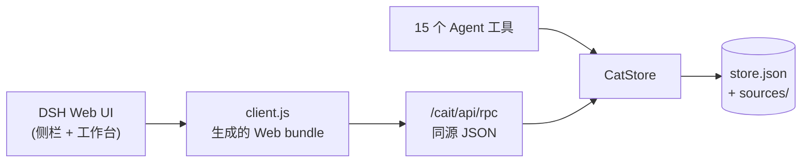

<p align="center">
  
</p>

<h1 align="center">CAIT</h1>

<p align="center">
  <strong>在 DeepSeek Harness 中完成计算机辅助翻译。</strong><br/>
  翻译记忆 · 术语库 · 句段编辑器 · 机器翻译辅助 · 文档标签页 · Office / 字幕 / 本地化格式
</p>

<p align="center">
  <a href="README.md">English</a> · <a href="README.zh-CN.md">简体中文</a> · <a href="README.ja.md">日本語</a>
</p>

<p align="center">
  <a href="https://www.npmjs.com/package/dsh-cait"></a>
  
  
  
</p>

CAIT 为 DSH Web UI 和 DSH 桌面端增加一个 CAT 翻译工作台。它从左侧栏入口打开，
工作台与十五个 Agent 工具共用一个数据存储，覆盖从导入源文件到导出译文的完整流程。

> **已在 DSH `0.2.2-rc.1` 中验证。** CAIT 使用 DSH 自己的模型路由和凭据，
> 不会要求用户填写 API Key。内部回退提供方仍叫 `mock`，界面显示为
> **术语替换（离线）**。

## 为什么选择 CAIT

| | |
|---|---|
| **原生集成 DSH** | 真正的侧栏入口、主工作台、DSH 主题令牌，以及人和 Agent 共用的同一份数据。不是 iframe，也不是另一个独立应用。 |
| **可解释的翻译记忆** | 支持多个 TM 库、仅检索已挂载库、上下文 101%、精确/近似精确/高/中/低模糊等级，确认句段时自动写回。 |
| **术语感知编辑** | 支持多个术语库、按源语言过滤、行内高亮、点击插入术语，以及按术语设置是否区分大小写。 |
| **完整文档流程** | 文档标签页、关闭/重新打开、最近文档清理、重复导入复用、逐文档进度。 |
| **真实格式覆盖** | TXT、Markdown、DOCX、EPUB、TMX、CSV、SRT/VTT、PO、XLIFF 1.2/2.0/SDLXLIFF、HTML、JSON、XLSX、PPTX、RTF。 |
| **面向 Agent** | 十个工具共享当前文档和存储，Agent 可以与用户同时翻译。 |

## 快速开始

1. 安装 CAIT，然后从左侧栏的 **CAIT** 入口打开。
2. 选择 **新开页面**，拖入源文件或粘贴文本。
3. 设置源语言和目标语言。
4. 翻译当前句段；右侧面板会显示 TM 匹配、术语命中和 MT 建议。
5. 点击 **确认并下一句**，句对会写入默认挂载的 TM。
6. 导出纯译文、双语对照，或保留源格式的文档。

编辑器中的输入只是草稿，保存在内存里。确认句段（或执行明确的结构性修改）时
才会写入快照。打开的工作台每两秒轮询一次 Host revision，因此 Agent 触发的修改
无需手动刷新即可出现。

## 功能

### 翻译记忆

- 支持多个 TM 库，每个库有 id、名称、挂载状态和默认写入库。
- **上下文匹配（ICE）为 101%。** 每次确认都会记录前后两句源文；之后相邻句相同的
  句段得 101%，等级为 `context`；文本相同但相邻句不同仍为 100%。每个 key 最多保留
  8 条上下文变体，并且始终保留无上下文的那一条。
- 支持精确、近似精确和三个模糊等级：
  - `near_exact` 使用忽略数字、标点和空白后的 key 比较，不依赖分数阈值。
  - `high_fuzzy` 为 `>= 0.85`，`medium_fuzzy` 为 `0.75–0.85`，
    `low_fuzzy` 低于 `0.75`（高于可配置下限，默认 `0.55`）。
- 模糊评分是词法级的：72% 字符二元组 Dice + 28% token Jaccard。
  拉丁文本按单词切分，CJK 文本按单字切分；不做词干、同义词或语义匹配。
- 检索只查已挂载的库。`cat_submit_translation` 支持可选 `targetTmId`；
  未挂载的目标库会以 `TM_NOT_MOUNTED` 拒绝写入。
- `bootstrap().tm.entries` 是已挂载条目的 40 条预览；
  `bootstrap().tm.count` 是已挂载数量，`bootstrap().tm.total` 是所有库的总数。
  完整数据请使用 `cat_lookup_tm` 或库面板。
- 支持 TMX 1.4 `<tu>/<tuv>/<seg>` 导入/导出。TMX 内联占位符会扁平化为
  纯文本，并给出明确警告。上下文以 `<prop type="x-context">` 往返，所以 CAIT
  自己导出的文件再导入后仍保留 101% 匹配。

### 术语库

- 支持多个术语库，每个库有挂载状态和默认写入库。
- 源文行内高亮，点击术语 chip 即可插入。
- 支持 CSV/TSV 导入、术语备注、源语言过滤，以及工作台和
  `cat_lookup_glossary` 都遵循的 `caseSensitive` 标记。
- 语言代码会规范化（`EN` → `en`，`ZH_cn` → `zh-CN`）。
- 任何库（无论是否挂载）里的条目都能编辑或删除；挂载状态只决定工作台搜索
  和写入哪些库。
- **术语提取**：术语库工具栏的「从文档提取术语」会列出候选词，带出现次数、
  记忆库里已有的译法和「已有」标记。统计负责找候选并排序（拉丁 n-gram；
  中日韩重复子串用左右邻接熵过滤），模型只判断一份短名单——这正是模型擅长
  的部分。

### 库页面

顶栏的「文档 / 库 / 对齐」在三个工作区之间切换，库页面不需要打开文档。

- TM 一张表、术语一张表，支持分页（20/50/100/200，会记住）、语言筛选，以及
  可限定在任意若干库内的搜索。
- 右侧边栏直接编辑选中的条目、新增条目，并在有未保存改动时提示。
- TM 导出 **TMX**；术语库导出 **TBX**、**CSV** 或 **JSON**。导入与清空仍在同一
  个工具栏里。
- 右侧面板的库按钮会把面板当前的搜索词一起带进库页面，在面板里查到的东西
  可以接着在完整列表里看。

### 对齐

顶栏的「文档 / 库 / 对齐」第三个视图用两份成品文件建记忆库：源文一份、
译文一份，可以是完全不同的语言，格式任选。

- 跨语言打分：共享锚点（数字、`{0}` 占位符、URL、首字母大写的名字）、按语言
  归一化的长度比例、段落结构。刻意不用字面相似度，因为它比不了两种语言。
- 分块动态规划可以配对 1:1、1:0、0:1、2:1、1:2；每行分高置信 / 待确认 / 可疑
  三档，只有高置信默认勾选。
- 写入前每行都能与下一行合并、按换行拆开或删除；目标库在工具栏里选，完全
  相同的条目会被跳过而不是重复写入。

### 工作台

- 按段落/句子切分，并逐句编辑译文。
- 句段三态：**待译** → **待审** → **已确认**，同时记录每句译文的来源
  （`tm`、`mt`、`agent`、`manual`）。句段栏可按状态筛选，搜索覆盖原文、
  译文和建议。
- **句段分页**：句段栏按 20/50/100/200 的页大小分页，并有一个输入框可直接
  跳到某个编号。如果目标句段被当前筛选隐藏，跳转时会先清空筛选。
- **预翻译** 用 TM 精确命中加机器翻译把整篇铺底：按小块推进，显示
  `已完成/总数`，可在块与块之间停止；已确认或已有译文的句段永远不会被覆盖。
- **上下排列的审校区**：原文、机器/agent 基线、可编辑译文从上到下依次排列，
  每一块都占满面板宽度。**全部确认** 在一次确认弹窗后接受所有待审句段。
- 支持保存草稿、确认并下一句、上一句/下一句导航和进度。当前句段与草稿会
  防抖落盘，重启后能回到原位。
- **重复句段自动同步**：确认一句后，本文档里其它相同原文的未确认句段会填上
  同一译文（来源 `auto`），编辑草稿也会同步；「铺满重复句段」可一次性处理整篇。
  已确认的句段永远不动。
- 句段栏里的 QA 提醒与导出前的汇总：占位符/标签缺失、数字不一致、
  术语未使用、空译文、译文仍是原文、同一原文多种译法。只提醒，不阻挡导出，
  也不写盘。
- 文档标签页；关闭标签页不会删除文档。
- **打开已有文档** 可重新打开已关闭的文档。
- **设置 → 界面** 提供界面语言切换：跟随 DSH 语言（默认）、简体中文、English、
  日本語。工作台与侧栏名称立即生效，且只改 CAIT 界面，不会改动文档的源语言或
  目标语言。
- 下拉框旁的垃圾桶按钮可删除一个或全部已关闭文档；删除是永久性的，
  不会影响 TM、术语库或其他文档。
- 同格式、同内容的再次导入会复用已有文档，而不是新建重复文档。
  指纹覆盖语言、源文、格式和交换元数据。
- 响应式密度：工作台测量自身 DSH 面板，并应用经过衰减的 1×–1.45× `--cait-u`
  缩放系数。1600×900 面板约为 1.17×，最大化的 4K 面板停在 1.45×：
  大窗口贴近 DSH 自带界面，不再比宿主明显放大。
- 工作台跟随 DSH 的亮/暗主题，包括原生控件（`color-scheme`），
  下拉框、复选框和滚动条都与面板一致。

### 预处理

导入的源文在切句之前会经过预处理阶段：

- 折叠重复空格与制表符、去掉行首缩进、合并连续空行。
- 移除零宽字符和多余的控制字符。
- 占位符 token（`{1}`、`{2}`…）、标点、大小写和段落顺序保持不变，
  因此 XLIFF/HTML/EPUB 的内联标记仍可正确往返。
- 三个步骤可在 **设置 → 预处理** 中分别开关，并随其他设置一起持久化。
  它们作用于新导入和 `createDocument` 调用，不会改写已有文档。

### MT 辅助

CAIT 不持有 endpoint 或 key，选择器完全来自 DSH：

- `ctx.llm.listProviders()` 提供已注册的提供方路由。
- 可用时通过 `ctx.loader.entries()` 查询 `config.providers`。
- `ctx.llm.listModels(provider)` 提供模型 id；CAIT 默认选择第一个模型。
- `ctx.llm.stream({ provider, model, messages, temperature, purpose: 'cait-mt' })`
  执行调用；CAIT 只拼接 `text-delta` chunk。

如果没有可用路由、所选路由消失或没有模型，CAIT 会回退到离线术语替换，
并在 UI 和 `cat_suggest_mt` 结果中明确说明。流式调用失败时，Host 日志记录
provider/model/code/status，客户端只会收到 `MT_PROVIDER_FAILED`。

## 支持的格式

| 格式 | 导入 | 导出 | 说明 |
| --- | :---: | :---: | --- |
| TXT / Markdown | ✅ | ✅ | 按段落和句子切分 |
| CSV | ✅ | ✅ | 自动识别逗号、分号、制表符或竖线分隔；可通过表头名称或从 1 开始的列号指定源/目标列；现有双语导出 |
| DOCX | ✅ | ✅ | 正文段落；导入时排除表格块。导出会修改原包，保留样式、编号、图片、页眉、表格和版式。 |
| EPUB | ✅ | ✅ | 按 EPUB 3 spine 顺序读取 XHTML 文本块，内联标记保留为 token 并回写到保留的源包。不支持 DRM、固定版式和脚本化 EPUB。 |
| TMX 1.4 | ✅ | ✅ | 常见 `<tu>/<tuv>/<seg>` 子集；内联标记扁平化并警告；上下文用 `<prop type="x-context">` 往返 |
| SRT / WebVTT | ✅ | ✅ | 一个字幕 cue 对应一个句段；保留时间轴/设置/标识；保留语义标签；非法时间范围会拒绝 |
| PO | ✅ | ✅ | 支持上下文、复数形式、译者注释和废弃 `#~` 条目 |
| XLIFF 1.2 | ✅ | ✅ | 内联标签转换为 `{n}` token；缺少 token 时阻止确认 |
| XLIFF 2.0 | ✅ | ✅ | 基础 `<unit><segment><source>/<target>` 子集 |
| SDLXLIFF | ✅ | ✅ | 走基础 XLIFF 1.2 路径；SDL 专有扩展不会完整往返 |
| HTML | ✅ | ✅ | 保留文本块与内联标签；不重建文档级 CSS/版式 |
| JSON | ✅ | ✅ | 字符串路径子集；通过模板保留对象/数组结构；key 和数字不翻译 |
| XLSX | ✅ | ✅ | 第一个工作表；识别 `Source`/`Target` 表头或 A/B 列；导出为新的两列表格 |
| PPTX | ✅ | ✅* | 保留源格式导出；需要导入时保留的 `.pptx` 包。仅正文；备注/图表/SmartArt 不导入。 |
| RTF | ✅ | ✅ | 基础段落、`\uN`、`\'hh`、控制字；不往返原始样式 |

\* 如果保留的源包不存在，PPTX 导出会以 `PPTX_SOURCE_REQUIRED` 失败，
而不是静默生成一个没有格式的演示文稿。

交换元数据（字幕时间轴、PO 上下文/复数/注释、XLIFF id 和内联 token 映射、
JSON 路径/模板、XLSX 行号、PPTX 幻灯片/段落位置、EPUB spine href 和块序号）
会保存在文档/句段上，并随快照持久化。

### 不支持 PDF

CAIT 不导入 PDF，后续版本也不会加入 PDF 支持。PDF 是固定版式的打印格式，
没有逻辑段落、阅读顺序或内联标记；从中提取的文本会散落在绘图指令之间，
丢失标题、表格和内联强调，切出的句段对翻译记忆和 MT 都是很差的输入——
也就是说，PDF 极其不适合 AI 相关工作。

如果需要翻译 PDF 内容，请先转换成支持的格式，例如：

```sh
pandoc input.pdf -t docx -o output.docx   # 或 -t html、-t markdown
```

也可以使用 Adobe Acrobat 的 **导出为 Word/HTML**、LibreOffice，或其他能生成
DOCX、HTML、EPUB 或纯文本的工具。扫描版 PDF 在转换前还需要 OCR；
CAIT 没有图片 OCR 阶段。

## 安装

CAIT 以 DSH bundle 的形式安装；发布的 npm 包名为 `dsh-cait`，插件本身在左侧栏显示为
**CAIT**。`desktop` 配置档由应用的 plugin manager 管理，请通过它安装，不要手写配置档的
`package.json`。

### 从 npm 安装

在 DSH 桌面端（或任何带有 `plugin_manager` 工具的配置档）中：

```text
plugin_manager install_bundle target: dsh-cait
```

需要固定版本时写 `dsh-cait@1.1.3`，需要最新版时写 `dsh-cait@latest`。管理器会解析 registry
上的包、应用 bundle patch 并激活插件，不需要手工在配置档里加行。

使用 CLI 管理的配置档：

```sh
dsh plugin --profile web add dsh-cait
```

将 `web` 替换为你的配置档名称。如果 Host 需要重启，请重启 `dsh web`。

### 从本仓库安装

GitHub：

```text
plugin_manager install_bundle target: github:JoviLecca/dsh-CAIT
```

本地目录：

```text
plugin_manager install_bundle target: /absolute/path/to/dsh-CAIT
```

然后重新加载 DSH。左侧栏会出现 **CAIT** 入口。

### 从源码安装

```sh
git clone <this-repository> dsh-CAIT
cd dsh-CAIT
npm run build:client
```

本地 `--patch` 覆盖层可以添加一行指向当前目录：

```yaml
# _dev/cait.patch.yml
- insert:
    - id: cait-dev
      name: 'C:\absolute\path\to\dsh-CAIT'
```

```powershell
dsh web --patch C:\absolute\path\to\dsh-CAIT\_dev\cait.patch.yml
```

`--patch` 是启动器选项；放在应用名（`web`）之后、应用自身参数之前。
覆盖层和配置档中已安装的 bundle 二选一，不要同时使用。

## 配置

| 选项 | 默认值 | 含义 |
| --- | --- | --- |
| `dataDir` | `""` | `store.json` 和 `sources/` 的目录。为空时使用 `$DSH_HOME/cait`。支持绝对路径、相对路径和 `~/...`。 |

```yaml
- id: dsh-cait
  name: dsh-cait
  config:
    dataDir: 'D:\CAT\cait-data'
```

快照保存文档、打开的标签页、TM、术语库、库、挂载关系和非敏感设置。
导入的 DOCX/PPTX/EPUB 源包放在 `sources/` 下。

界面内的**设置**保存在快照里，而不是上面的 YAML：源语言/目标语言、模糊阈值、
TM 返回条数、MT 路由/模型/温度，以及界面语言（`uiLang`：`auto` | `zh` | `en` |
`ja`，默认 `auto` 即跟随 DSH 语言）。

句段确认使用严格写入：如果快照无法写入，确认会以 `PERSISTENCE_FAILED`（503）
失败，并回滚内存中的确认。其他结构性修改采用尽力写入，并通过工作台横幅显示
`bootstrap().storage.error`。

如果快照损坏或版本未知，CAIT 会记录警告，将其移动到
`store.json.corrupt-<timestamp>`，然后以空状态启动，而不是让插件激活失败。
版本 1、2 快照会迁移到版本 3，并创建默认 TM 和术语库；版本 2 里「有译文但未
确认」的草稿会变成 `translated`，来源记为 `manual`。

## Agent 工具

| 工具 | 用途 |
| --- | --- |
| `cat_get_segment` | 获取当前句段及 TM 匹配、术语命中 |
| `cat_submit_translation` | 确认译文，写入已挂载 TM（可选 `targetTmId`），前进到下一句 |
| `cat_lookup_tm` | 在已挂载库中按等级检索 TM |
| `cat_lookup_glossary` | 查询已挂载术语库；遵循 `caseSensitive` |
| `cat_list_documents` | 列出文档和进度 |
| `cat_switch_document` | 选择活动文档 |
| `cat_suggest_mt` | 通过所选 DSH 路由调用 MT，或使用明确的离线回退 |
| `cat_pre_translate` | 用 TM + MT 填一块，跳过已确认/已有译文的句段，返回 `next` |
| `cat_get_segments` | 取一段有界句段窗口，含状态、来源和建议 |
| `cat_confirm_segments` | 确认索引列表、一段窗口，或全部待审句段 |
| `cat_propose_translation` | 只留下建议和理由，不动已确认的译文 |
| `cat_align` | 对齐两段文本，报告高置信 / 待确认 / 可疑的配对 |
| `cat_consistency_report` | 按原文分组列出译文不一致的句段 |
| `cat_term_candidates` | 术语候选短名单：频次、例句、记忆库里已有的译法 |
| `cat_add_terms` | 一次性把选中的术语写进术语库 |

因此 Agent 可以完全不点界面就把整篇铺底：反复调用 `cat_pre_translate`
（`from: next`）直到 `next` 为 `null`，用 `cat_get_segments` 查看，再用
`cat_confirm_segments` 批量接受。做术语时读 `cat_term_candidates`，判断这份
短名单，再用 `cat_add_terms` 写入。

工作台和工具共用一个 `CatStore`，因此 Agent 可以翻译用户当前打开的同一份文档。

## 架构



- **Host**（`index.js`、`lib/`）负责存储、持久化、导入/导出、工具和私有 API。
- **Client**（`client/`）是通过 DSH 模块加载器加载的普通 React，渲染到
  `sidebar.panellist` 和 `main`。样式只使用 `--dsw-alias-*` 令牌。
- `client.js` 是生成文件；请修改 `client/*.js`，然后运行 `npm run build:client`。

<details>
<summary><strong>项目结构</strong></summary>

```text
cait/
├─ package.json
├─ cordis.patch.yml
├─ index.js                 # Host 端
├─ client.js                # 生成的 Web bundle
├─ client/                  # helpers、styles、RPC、components、locales、entry
├─ scripts/build-client.mjs
├─ icon.svg
├─ locale/{en,zh,ja}.json
├─ NOTICE
├─ README.md
├─ README.zh-CN.md
├─ README.ja.md
├─ CHANGELOG.md
├─ lib/
│  ├─ store.js              # CatStore 门面 + 文档/句段核心
│  ├─ errors.js
│  ├─ store-utils.js
│  ├─ libraries.js          # TM/术语库注册表 + 挂载
│  ├─ tm.js
│  ├─ glossary.js
│  ├─ persistence.js
│  ├─ import-export.js
│  ├─ formats.js            # CSV/SRT/VTT/PO/XLIFF/HTML/JSON/RTF
│  ├─ html.js               # 共享 HTML/XHTML 文本块扫描与回写
│  ├─ epub.js               # EPUB 包读取 / spine 导入 / 回写导出
│  ├─ preprocess.js         # 导入期源文预处理阶段
│  ├─ xlsx.js
│  ├─ pptx.js
│  ├─ segmenter.js
│  ├─ similarity.js
│  ├─ tmx.js
│  ├─ docx.js
│  ├─ markdown.js
│  ├─ xml.js
│  ├─ mt.js
│  ├─ tools.js
│  └─ api.js
└─ _dev/                    # 测试、fixture、本地 patch 覆盖层
```

</details>

## 开发

需要 Node.js 22+ 和 DSH `0.2.x`。已在 DSH `0.2.2-rc.1`、Node `26.7.0`
中测试。

```sh
npm run build:client
node --check client.js

node _dev/test-core.mjs
node _dev/test-imports.mjs
node _dev/test-formats.mjs
node _dev/test-epub.mjs
node _dev/test-preprocess.mjs
node _dev/test-second-tier.mjs
node _dev/test-docx-export.mjs
node _dev/test-api.mjs
node _dev/test-plugin.mjs
node _dev/test-persistence.mjs
node _dev/test-documents.mjs
node _dev/test-libraries.mjs
node _dev/test-mounts.mjs
node _dev/test-ui-scale.mjs
node _dev/test-mt.mjs
```

导入/导出 fixture 为 `_dev/sample.docx`、`_dev/sample-table.docx` 和
`_dev/sample-format.docx`；可用对应的 `python _dev/make-*.py` 脚本重新生成。
15 套测试应全部通过。

### 发布

`npm publish` 会触发 `prepublishOnly`：从 `client/` 的片段重建 `client.js`
并做语法检查，因此发布出去的不会是一个过期的 bundle。在仓库根目录执行：

```sh
npm publish
```

`.github/workflows/publish.yml` 会在 GitHub 发布 release 时做同样的事，使用
npm Trusted Publishing（OIDC）而不是保存的 token，并且当 release tag 与
`package.json` 的版本不一致时拒绝发布。

首次发布必须在本地完成，因为 Trusted Publishing 只能为已经存在的包配置：

```sh
npm login
npm publish
```

之后在 npmjs.com 打开该包，进入 **Settings → Trusted publishing**，添加仓库
`JoviLecca/dsh-CAIT` 和 workflow 文件 `publish.yml`。以后的版本就可以通过
GitHub release 发布。

## 安全模型

- Host API 挂载在 `/cait/api`，通过 `ctx.connection.requestRejection`
  限制为同源/受信任请求。
- RPC 请求体为 JSON，上限 32 MB；超过时返回 `413 BODY_TOO_LARGE`。
- `clearTM` / `clearGlossary` 除了浏览器信任检查外，还要求
  `params.confirm === true`；UI 会在发送前询问。
- CAIT 从不接收、存储或返回 API Key。DSH 凭据保留在所选提供方适配器内部。
- 持久化使用单个快照，语义为最后写入者获胜；它不是多用户日志。

## 已知限制与路线图

- 不支持 PDF 导入；PDF 已被明确排除在范围外（见
  [不支持 PDF](#不支持-pdf)）。暂不支持图片 OCR。
- EPUB 导入只覆盖 spine 中的正文 XHTML 文本块；不支持 DRM、固定版式、
  脚本化以及大量使用 MathML 的电子书。
- DOCX 导入会跳过表格、页眉、脚注、域、替代文本和修订删除内容。
  DOCX 导出时这些区域保持源语言。
- DOCX/PPTX 中混合 run 的段落会继承第一个 run 的格式。
- PPTX 导入只覆盖正文，不包含备注、图表或 SmartArt。
- XLSX 导入/导出是两列表格；不保留单元格样式、公式、合并单元格、图片和额外工作表。
- HTML/RTF 导出不往返原始样式；JSON 只翻译字符串值。
- TM 匹配是词法级的，不是语义级；没有词干、同义词或向量。
- 每个上下文下，同一原文存一条译文：重复的句子会为每种相邻句组合保留一条变体，
  每个 key 上限 8 条；相邻句不同时回落到无上下文的通用条目。
- 上下文只取前后两句源文，不包含文档、客户或项目元数据。
- TBX 与 JSON 术语导出是单向的；只有 TMX 和 CSV 能再导入回来。
- 工作台界面提供中文、English、日本語三种语言，可在设置中切换；README 提供英文、简体中文和日文三个版本，以英文版为准。

后续计划：通过多模态 DSH 路由支持图片/视觉输入、保留样式的 XLSX 输出，
以及 XLIFF `<alt-trans>` / 注释支持。

## 变更日志与版本

见 [CHANGELOG.md](CHANGELOG.md)。`v1.0.0` 是首个公开发布版本，`v1.0.1` 增加了
日语界面和界面内语言切换，`v1.0.2` 让「跟随 DSH 语言」真正跟随 DSH 的语言设置，
`v1.0.3` 把包发布到 npm，`v1.0.4` 起后续版本改由带 provenance 的发布流水线产出，
`v1.0.5` 增加 EPUB、导入预处理和 PDF 政策，`v1.1.0` 增加 agent 驱动的预翻译、
句段三态、上下排列的审校区和轻量 QA，`v1.1.1` 增加带 TMX/TBX/CSV/JSON 导出的
库页面、句段分页，以及从右侧面板跳进库页面，`v1.1.2` 增加带 101%（ICE）
匹配的上下文记忆，`v1.1.3` 增加双文件对齐、重复句段自动同步、术语提取，
以及 agent 写建议用的原语；项目在开发阶段使用 `0.1.0`，
发布到 GitHub 前统一改为 `1.0.0`。

> **License：** Apache License 2.0，见 [LICENSE](LICENSE)。再分发时需保留
> [NOTICE](NOTICE) 中的署名信息。
